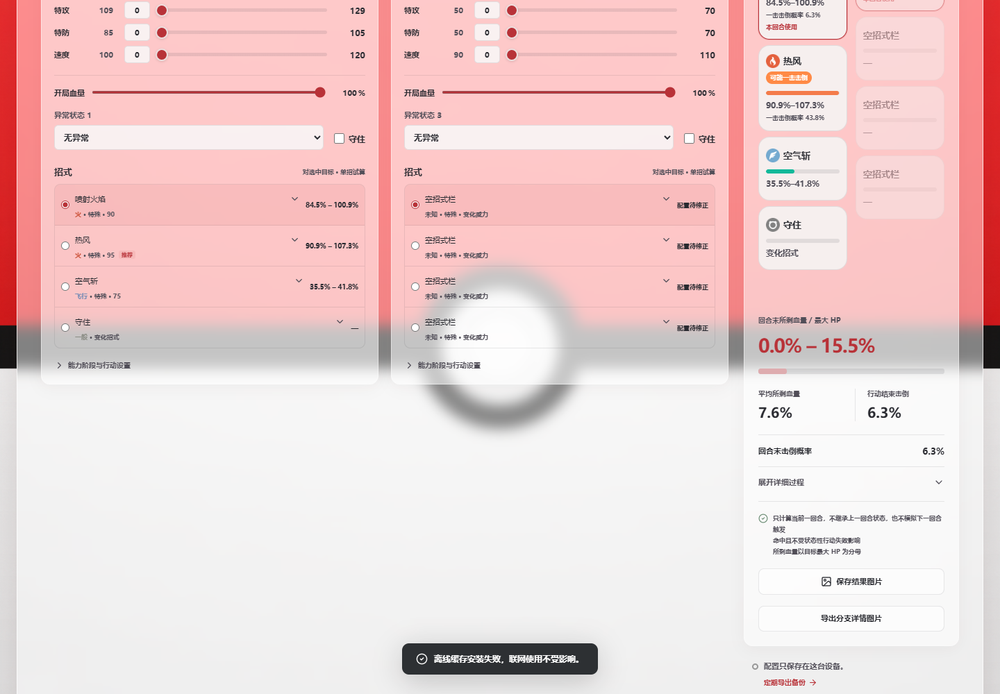
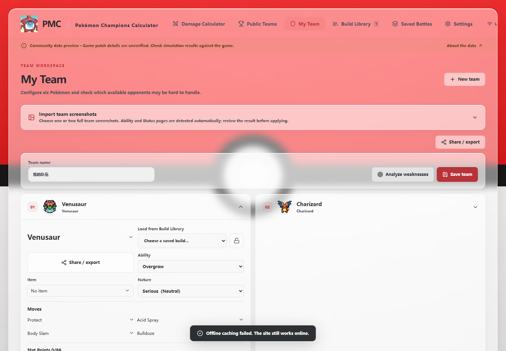

# PMC · Pokémon Champions Calculator

[简体中文](README.zh-CN.md) · [GitLab Pages](https://pmc-babb04.gitlab.io/) · [GitHub Pages mirror](https://swag-dragon86.github.io/pmc/)

PMC helps Pokémon Champions players compare damage, survival and competitive builds. Version **1.4.0** includes a public browser app and a locally built Android offline app, with English, Simplified Chinese, Traditional Chinese, Japanese and Korean interfaces. The project uses React, Vite and a Champions-specific community calculation engine. It has no account service or application database.

The game data targets **Champions 1.2.0, regulation M-C, season M-6**, effective September 9, 2026 at 02:00 UTC through December 2, 2026 at 01:59 UTC. This game-data version differs from the app version. The catalog includes 350 forms, 509 associated moves, 216 ability names and 166 held items, plus the no-item option. See the [official regulation announcement](https://champions-news.pokemon-home.com/en/page/816.html). Coverage does not mean that every mechanic has passed in-game validation.

## Features

- Singles and doubles focus-fire calculation, selectable move cards for four slots, damage ranges and current-turn HP results. Defender B starts passive and can act when enabled with a selected move.
- Champions Stat Points: 66 total, 32 per stat. Configure nature, ability, held item, HP, status, stages, weather, terrain, screens and supported field effects.
- My Team, saved builds, saved scenarios, local persistence and JSON backups with import previews and conflict handling.
- Public teams with online checks on opening/returning, every five minutes while viewing the page, and on demand. Times use the device's timezone. Availability depends on upstream snapshots and network access.
- Local OCR import of one or two full-team screenshots, with a preview before confirmation. Results depend on language, image quality and layout.
- Landscape team cards, portrait Pokémon cards and damage report images. Embedded PMC QR codes carry editable configurations across interface languages. Choose from 37 Poké Ball themes.
- Temporary configuration locks, search aliases, light/dark themes, custom backgrounds and PWA caching. Android uses system document selection and saving.





These are actual application captures, not design mockups. The team image comes from the pre-fix 1.4.0 audit sample.

## Run locally

Use Node.js 24 and pnpm 11.25.0. Keep the lockfile:

```sh
npm install --global pnpm@11.25.0
pnpm install --frozen-lockfile
pnpm dev
```

Vite prints the local URL and binds to localhost. Test and build:

```sh
pnpm test
pnpm build
pnpm preview
```

Deploy **dist/**. Both Pages configurations use the same source, a relative asset base and static navigation. The build prepares the team snapshot and local OCR resources, builds the website and generates its service worker. OCR assets come from installed npm packages; no paid API or developer's cached model directory is required. First-time browser OCR needs those resources online before caching.

The repository includes GitLab and GitHub Pages deployment workflows. The pull-request workflow tests and builds without publishing. See the [Pages guide](docs/免费Pages部署指南.md). Hosting configuration cannot guarantee mainland China connectivity.

## Android build

Android requires Windows, the downloaded JDK 17/Android tools and a recent Android System WebView. Package ID: `cn.pmc.calculator`; minimum Android 8.0 (API 26).

```powershell
./scripts/setup-android.ps1
node scripts/build-android.mjs --unsigned
python scripts/verify-android.py output/android-unsigned/build-info.json
```

The output under **output/android-unsigned/** is for build verification. An unsigned APK is not an installable release. `PMC_ANDROID_TOOLS` can point to an existing tools directory. The build prepares the worker, four WASM JavaScript bundles and five OCR models; the verifier checks packaged resources.

The maintainer's release command, `node scripts/build-android.mjs`, uses or creates private signing material under ignored `output/android-signing/`. **Restore the original signing identity before building an update for existing installations.** A replacement key cannot update them. Never commit or distribute signing files. This preparation does not sign or publish a new APK. There is no verified public APK download URL to list; local artifacts are not evidence of a GitHub Release.

## Calculation scope

Enable community calculation to see numerical results. PMC simulates the configured entry turn through its end, not an entire battle. The interface has no previous-turn or turns-on-field input. Old scenes retain the entry-turn assumption; the engine rejects Fake Out when a scene explicitly records `activeMoveActions > 0` for that user. Guaranteed flinch respects protection and supported immunities. Optional flinch effects still follow the existing secondary-effect toggle; these are conditional results, not unconditional in-game probabilities.

Full switching, Parting Shot's complete switch sequence, complex multihit moves and some item/ability chains remain unsupported. Identified unsupported combinations retain their warning or full-turn gate. Supported events use exact branches; excessive branching stops with an explanation instead of silently sampling. Hit/miss and status-based action failure are not fully modeled. See [mechanics regression notes](docs/MECHANICS-REGRESSIONS.md).

The earlier audit passed 126 Node tests, checked 52,500 stat-formula cases and scanned 509 move entry points. Those were **not physical game tests** or exhaustive verification of every interaction. Run the current suite for the latest test count. See [CHANGELOG](CHANGELOG.md).

## Local data and sharing

Builds and scenarios live in the current browser origin or Android app. Backgrounds use IndexedDB. There is no cloud sync. Export a full JSON backup before moving devices or URLs; clearing storage or uninstalling can remove records. Existing schema-1 backups and PMC1 share codes remain supported. A QR image contains the shared build, team or scenario, not your entire library.

Data regeneration is a maintainer task. `node scripts/prepare-data.mjs` uses vendor snapshots pinned in `src/data/sources.json`; `pnpm data:teams` contacts public sources to update the team snapshot. These are separate from a normal app build. Game-data changes require review and tests.

## License and provenance

The maintainer licenses PMC's original program code under **GPL-3.0-or-later**; see [LICENSE](LICENSE) and [scope](docs/LICENSING.md). Third-party code and dictionaries retain their own licenses, including MIT Smogon/Showdown components and GPLv3 Chinese dictionaries. See [THIRD_PARTY_NOTICES](THIRD_PARTY_NOTICES.md).

**Artwork replacement (2026-10-23):** 350 Pokémon form image files now have contributor permission records: 277 use SpriteCollab artwork and 73 use The Artificial’s CC-BY author statement, all 18 type icons use James Watkins / partywhale’s MIT-licensed redrawings, 37 balls use Cobblemon Assets art under CC BY-NC 3.0, and the mascot/icon family uses Emmuffin’s SpriteCollab Rotom Dex portrait. Historical SpriteCollab attribution / not-for-profit permissions and CC BY-NC 4.0 are recorded per selected frame. SpriteCollab supplies 198 full-body frames and 79 portraits; The Artificial supplies 73 vector-style icons. Paths and layout are retained. See [artwork credits](docs/ASSET_CREDITS.md) and [remaining gaps](docs/ASSET_RIGHTS_REMAINING.md). **The maintainer removed the unverified Strange Ball; 37 ball themes remain. The eight repository screenshots have been recaptured with component credits. The default background is maintainer-confirmed original, retained unchanged; no standalone reuse license has been selected. Contributor permissions are not complete official IP clearance.**

PMC is an unofficial fan project with no endorsement from Pokémon's owners. Source URLs record provenance; they do not establish permission to redistribute images.

## Feedback and contribution

[Report a bug or request a feature](https://github.com/SWAG-Dragon86/pmc/issues). For a calculation error, include the app/data version, full scene, expected and actual values, and a reliable rule reference or in-game evidence. Remove personal information before sharing backups or screenshots. See [CONTRIBUTING](CONTRIBUTING.md).
